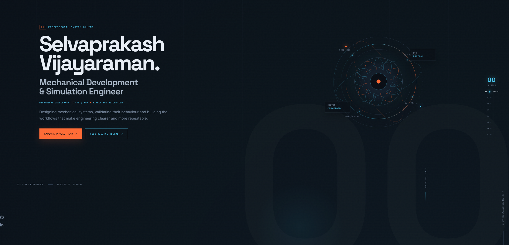

# Selva Engineering Portfolio

A bilingual, cinematic engineering portfolio for **Selvaprakash Vijayaraman**, focused on mechanical development, CAE/FEM, simulation automation and data-driven engineering.

**Live website:** https://selvaprakash-vj.github.io/engineering-portfolio/  
**Deutsch:** https://selvaprakash-vj.github.io/engineering-portfolio/de/



## Purpose

This website is a professional evidence platform rather than a web-formatted CV. It connects career experience, engineering capabilities, education, a digital résumé and selected project case studies inside one personal engineering brand.

## Current release

**v1.1.0 — Bilingual Professional Release**

- Complete English and German homepage
- English and German digital résumé
- Bilingual MachineGuard AI case study
- Bilingual Finance Tracker Automation case study
- Language-aware routing, metadata and sitemap
- Desktop cinematic scrolling with lighter mobile behaviour
- Mobile-specific hero and career navigation
- GitHub Pages deployment through GitHub Actions

## Featured case studies

### MachineGuard AI

A reliability-aware predictive-maintenance platform for NASA C-MAPSS turbofan Remaining Useful Life prediction, including leakage-safe preprocessing, GRU modelling, uncertainty estimation, trajectory diagnostics, explainability and engineering decision support.

- [Live dashboard](https://machineguard-ai.streamlit.app/)
- [Source repository](https://github.com/Selvaprakash-Vj/MachineGuard-AI)

### Finance Tracker Automation

A private, local-first financial data-engineering workflow that standardises monthly statements, preserves human annotations exactly and applies machine learning only as a controlled fallback. The public portfolio exposes the architecture and engineering decisions—not personal financial data or private source code.

## Main routes

| English | Deutsch |
|---|---|
| `/` | `/de/` |
| `/resume` | `/de/lebenslauf` |
| `/projects/machineguard-ai` | `/de/projekte/machineguard-ai` |
| `/projects/finance-tracker` | `/de/projekte/finance-tracker` |

## Technology

- React
- TypeScript
- Vite
- GSAP and ScrollTrigger
- CSS-driven responsive interface
- GitHub Actions and GitHub Pages

## Local development

```powershell
npm install
npm run dev
```

## Quality and production checks

```powershell
npm run preflight
npm run qa:bilingual
npm run build
npm run preview
```

Clean obsolete development notes after applying an update:

```powershell
npm run cleanup:repo
```

Run the combined release check with:

```powershell
npm run release:check
```

The English CV must exist at:

```text
public/Selvaprakash_Vijayaraman_Resume.pdf
```

## Deployment

Pushes to `main` trigger `.github/workflows/deploy.yml`, which validates the public release, builds the GitHub Pages version and deploys the generated `dist` artifact.

```powershell
git add .
git commit -m "Describe the change"
git push
```

## Privacy boundary

This public repository must never contain bank statements, real transaction exports, credentials, environment files, personal finance configuration or private Finance Tracker source data. The release preflight checks for common sensitive filenames before deployment.

## Accessibility and responsive design

The portfolio includes keyboard focus states, semantic navigation, reduced-motion support, route announcements, mobile-specific layouts and lighter animations on touch devices.

## Repository structure

```text
.github/workflows/   GitHub Pages deployment
public/              Route shells, documents, icons and social previews
scripts/             Release and bilingual QA checks
src/                 React application, routing, content and animation
```

## Content and usage

Portfolio text, personal branding, visual design and project documentation are © 2026 Selvaprakash Vijayaraman. Third-party libraries remain subject to their respective licences.
